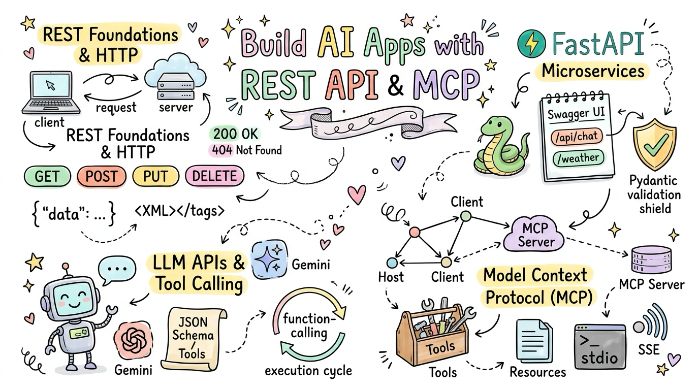
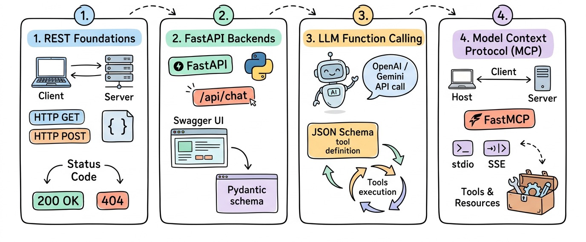

# Build AI Apps with REST API & MCP

[](LICENSE)
[](https://github.com/wlos/Connect-AI-using-REST-API/graphs/contributors)
[](https://github.com/wlos/Connect-AI-using-REST-API/issues)
[](https://github.com/wlos/Connect-AI-using-REST-API/pulls)
[](https://github.com/wlos/Connect-AI-using-REST-API/pulls)

[](https://github.com/wlos/Connect-AI-using-REST-API/watchers)
[](https://github.com/wlos/Connect-AI-using-REST-API/network/members)
[](https://github.com/wlos/Connect-AI-using-REST-API/stargazers)
[](https://mybinder.org/v2/gh/wlos/Connect-AI-using-REST-API/main)
[](https://github.com/wlos/Connect-AI-using-REST-API/discussions)



Welcome to the **Build AI Apps with REST API & MCP** curriculum (aligning with **ICTPRG553 Create and develop REST APIs**). This repository provides vocational learners and software engineers with hands-on, practical foundations in connecting artificial intelligence models with enterprise systems through robust RESTful web services, FastAPI microservices, and the Model Context Protocol (MCP).

- 🌐 **Course Website**: <https://wlos.github.io/Connect-AI-using-REST-API/>
- 🗺️ **Interactive Roadmap**: [Mindmap of the Course](mindmap.html) · [Online Mindmap](https://wlos.github.io/Connect-AI-using-REST-API/mindmap.html)

## 🛠️ What You'll Build

### 🎯 Core Competencies

- **Enterprise REST Architecture**: Design stateless, predictable RESTful services conforming to HTTP specifications, status codes, and authentication standards.
- **Production FastAPI Engineering**: Construct high-performance asynchronous API endpoints, define strict Pydantic schemas, and inspect automatic OpenAPI documentation.
- **LLM API Integration & Function Calling**: Call Gemini and OpenRouter APIs, maintain multi-turn dialogue histories, and equip chat assistants with callable tools.
- **Model Context Protocol (MCP)**: Implement standard MCP servers and clients using FastMCP, supporting stdio and HTTP transports for Claude Desktop and custom agents.

### 🏗️ Practical Projects

- **Enterprise Weather Microservice**: Wrap external weather APIs with FastAPI, validate query inputs, shape JSON responses, and document routes with Swagger UI.
- **Multi-Turn Autonomous Tool-Calling Chatbot**: Build a Python assistant that autonomously triggers local weather and arXiv research tools based on natural language queries.
- **FastMCP Multi-Tool Server**: Build and deploy an extensible MCP server serving live resources, dynamic prompts, and multiple callable tools.

### 🏢 Industry Applications

Cloud Software & SaaS · Enterprise IT Systems Integration · FinTech & Banking Services · AI-Driven Customer Support · Internal Developer Platforms

## 💼 Career Impact

- **Technical Roles**: API Developer · Backend Software Engineer · AI Integration Specialist · Full-Stack Developer · Cloud Systems Engineer
- **Industry Sectors**: Cloud Software & SaaS · Enterprise IT Consulting · FinTech & Banking · Telecommunications · Digital Agencies
- **Portfolio Projects**: Production FastAPI microservices · Autonomous tool-calling chatbots · Standardised MCP servers exposing custom corporate APIs

## 📚 Content



The course is organised into modular sessions located directly under the repository root. Supplementary practice scripts, assets, and sample datasets are housed within each session directory.

| Module | Topic | Focus Area | Key Content |
| :---: | :--- | :--- | :--- |
| 📖 [01](01-Introduction-to-REST-API) | [Introduction to REST API](01-Introduction-to-REST-API) | REST Foundations & Web Protocols | Client-Server Architecture · HTTP Request & Response · Status Codes · AuthN & AuthZ · XML & JSON with arXiv, NASA APOD & WeatherAPI |
| ⚡ [02](02-Creating-APIs-with-FastAPI) | [Creating APIs with FastAPI](02-Creating-APIs-with-FastAPI) | Backend Engineering & Validation | FastAPI Routes · OpenAPI / Swagger Docs · Pydantic Schemas · Query & Path Parameters · Weather Microservice & arXiv Endpoints |
| 🤖 [03–04](03-04-Building-a-Chatbot-with-LLM-API) | [Building a Chatbot with an LLM API](03-04-Building-a-Chatbot-with-LLM-API) | LLM APIs & Function Calling | Gemini & OpenRouter APIs · Multi-turn Dialogue State · Streaming · JSON Schema Tools · Autonomous Function Calling Loops |
| 🔌 [05](05-Introduction-to-MCP) | [Introduction to MCP](05-Introduction-to-MCP) | Model Context Protocol & Agents | MCP Architecture (Host, Client, Server) · FastMCP Server · stdio & HTTP Transports · Dynamic Tool Discovery · Multi-tool Chatbot |

## 🚀 Getting Started

### 🌐 Course Website

You can study all course notes and visual walkthroughs online without installing software by visiting the [Course Website](https://wlos.github.io/Connect-AI-using-REST-API/).

### ☁️ Hands-on Activities in Google Colab

Every practice notebook includes an **Open in Colab** link inside the corresponding lecture. In Colab:

1. Click **Open in Colab** from the lecture page.
2. Run the notebook from top to bottom. Each notebook automatically installs required dependencies and fetches data without needing a local checkout.

### 💻 Running Locally

To work with the notebooks and API servers on your local computer:

1. Clone this repository and change into the course directory:
   ```bash
   git clone https://github.com/wlos/Connect-AI-using-REST-API.git
   cd Connect-AI-using-REST-API
   ```

2. Create and activate a Python virtual environment (Python 3.10 or newer is recommended):
   ```bash
   python3 -m venv .venv
   source .venv/bin/activate
   ```

3. Install course dependencies:
   ```bash
   pip install fastapi uvicorn requests httpx fastmcp google-genai arxiv pydantic jupyterlab
   ```

## 🎓 Other Curricula

- 🤖 [Artificial Intelligence Skill Set](https://wlos.github.io/AI_SS/) · [GitHub](https://github.com/wlos/AI_SS): Classical ML, PyTorch CNNs, Computer Vision, and Hugging Face Transformers.
- 🐍 [Introduction to AI with Python](https://wlos.github.io/ai_with_python_course/) · [GitHub](https://github.com/wlos/ai_with_python_course): Programming fundamentals, algorithms, robotics with micro:bit & Maqueen, and basic AI.
- 📊 [Data Analysis with Python](https://wlos.github.io/DA_with_Python/) · [GitHub](https://github.com/wlos/DA_with_Python): End-to-end data analysis, Pandas, Matplotlib / Seaborn visualisations, and scikit-learn modelling.

## 📄 License

This repository is licensed under the [MIT License](LICENSE).
