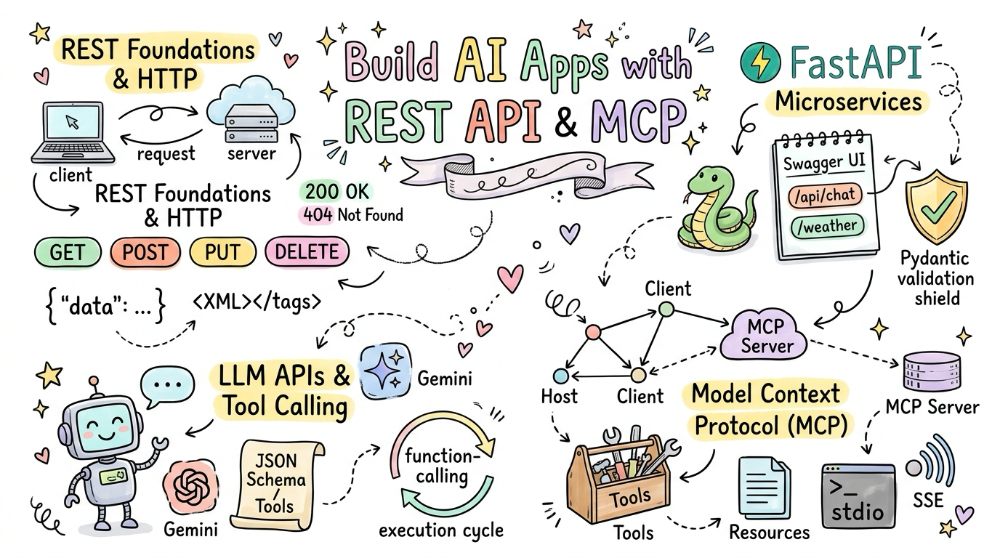
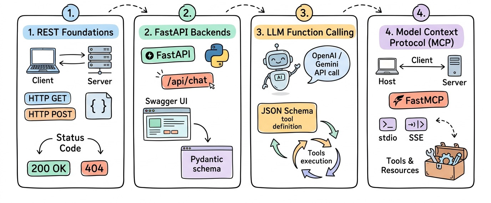

::: {.course-banner-container}
{.course-banner-img fig-alt="Build AI Apps with REST API and MCP Sketchnote Banner"}
:::

# Build AI Apps with REST API & MCP

Welcome to the **Build AI Apps with REST API & MCP** curriculum (aligning with **ICTPRG553 Create and develop REST APIs**). This course guides vocational learners and software engineers through connecting modern artificial intelligence models with enterprise backends and business data systems using robust REST architectures, FastAPI microservices, and the open Model Context Protocol (MCP).

🗺️ **Interactive Roadmap**: Explore our interactive [Mindmap of the Course](mindmap.html) for a zoomable, bird's-eye view of all curriculum topics and direct section links.

## 🧭 Course Navigation {#course-navigation}

::: {.course-banner-container}
{.course-banner-img fig-alt="Build AI Apps with REST API and MCP Curriculum Roadmap"}
:::

The curriculum is structured into modular session directories located directly under the repository root. Each session folder is completely self-contained with its own images, practice scripts, and sample datasets.

::: {.info-stack}
::: {.info-card}
#### 📖 [Session 01: Introduction to REST API](<01-Introduction-to-REST-API/Session 1 Introduction to Connect AI with Business Systems using REST.ipynb>)
[REST Foundations & Web Protocols]{.focus-badge}

Client-Server Architecture · HTTP Request & Response Anatomy · Status Codes (200, 404, 500) · Authentication vs Authorisation · XML & JSON Parsing with arXiv, NASA APOD & WeatherAPI
:::

::: {.info-card}
#### ⚡ [Session 02: Creating APIs with FastAPI](<02-Creating-APIs-with-FastAPI/Session 2 Creating APIs with FastAPI.ipynb>)
[Backend Engineering & Data Validation]{.focus-badge}

FastAPI Route Handlers · Interactive Swagger / OpenAPI Docs · Pydantic Request & Response Schemas · Query & Path Parameters · Weather Microservice & arXiv Endpoints
:::

::: {.info-card}
#### 🤖 [Sessions 03–04: Building a Chatbot with an LLM API](<03-04-Building-a-Chatbot-with-LLM-API/Session 3-4 Building a Chatbot with an LLM API.ipynb>)
[LLM APIs & Function Calling]{.focus-badge}

Gemini & OpenRouter API Integration · Multi-turn Conversation State · Streaming Responses · Tool Declarations with JSON Schema · Autonomous Function Calling Loops
:::

::: {.info-card}
#### 🔌 [Session 05: Introduction to MCP](<05-Introduction-to-MCP/Session 5 Introduction to MCP.ipynb>)
[Model Context Protocol & Extensible Agents]{.focus-badge}

MCP Architecture (Host, Client, Server) · FastMCP Server Development · stdio & Streamable HTTP Transports · Dynamic Tool Discovery & Resource Serving · Multi-tool Chatbot Integration
:::
:::

## 🎯 Core Competencies {#core-competencies}

::: {.info-stack}
::: {.info-card}
#### 🌐 Enterprise REST Design
Architect predictable, stateless RESTful APIs following standard HTTP semantics, status code conventions, and modern authentication patterns.
:::

::: {.info-card}
#### ⚡ Production FastAPI Development
Build high-performance asynchronous API services, enforce strict type contracts using Pydantic, and generate interactive OpenAPI documentation.
:::

::: {.info-card}
#### 🧠 LLM API Integration & Function Calling
Programmatically interact with leading generative AI models, manage multi-turn dialogue histories, and equip assistants with custom callable external tools.
:::

::: {.info-card}
#### 🔌 Open Agent Protocol (MCP)
Implement Model Context Protocol servers and clients, standardising how intelligent assistants discover and execute enterprise tools and inspect external resources.
:::
:::

## 🏗️ Practical Projects {#practical-projects}

::: {.info-stack}
::: {.info-card}
#### 🌦️ Enterprise Weather Microservice
Develop a production-ready FastAPI service that wraps third-party WeatherAPI endpoints, validates query inputs, filters nested payloads, and serves simplified JSON.
:::

::: {.info-card}
#### 💬 Multi-Turn Autonomous Tool-Calling Chatbot
Build an interactive command-line assistant powered by Gemini or OpenRouter that inspects user queries, calls weather or research tools via Function Calling, and incorporates live results into conversational answers.
:::

::: {.info-card}
#### 🛠️ FastMCP Weather & Research Server
Construct a standalone FastMCP server exposing structured weather forecasts and arXiv document searches, compatible with Claude Desktop and custom terminal clients via stdio and HTTP transports.
:::
:::

## 💼 Career Impact {#career-impact}

::: {.info-stack}
::: {.info-card}
#### 💼 Technical Roles
API Developer · Backend Software Engineer · AI Integration Specialist · Full-Stack Developer · Cloud Systems Engineer
:::

::: {.info-card}
#### 🏢 Industry Sectors
Cloud Software & SaaS · Enterprise IT Consulting · FinTech & Banking · Telecommunications · Digital Agencies
:::

::: {.info-card}
#### 📁 Portfolio Projects
FastAPI microservice with OpenAPI specs · Autonomous tool-calling chatbot · FastMCP server exposing custom business APIs
:::
:::

## 🚀 Getting Started {#getting-started}

::: {.info-stack}
::: {.info-card}
#### 🌐 In Your Browser
Read curriculum materials, examine architectural diagrams, and follow code walkthroughs directly on this website without local setup.
:::

::: {.info-card}
#### ☁️ Google Colab
Launch companion practice notebooks directly in Google Colab using the **Open in Colab** badges. Dependencies and sample datasets install automatically.
:::

::: {.info-card}
#### 💻 Local Development
Clone this repository and create a Python 3.10+ virtual environment (`.venv`) with FastAPI, Uvicorn, Requests, FastMCP, and the Gemini SDK to build and test servers locally.
:::
:::

## 🎓 Other Curricula {#other-curricula}

::: {.info-stack}
::: {.info-card}
#### 🤖 [Artificial Intelligence Skill Set](https://wlos.github.io/AI_SS/) · [GitHub Repository](https://github.com/wlos/AI_SS)
A comprehensive, code-first curriculum covering machine learning, PyTorch convolutional neural networks, computer vision, and Hugging Face Transformer models.
:::

::: {.info-card}
#### 🐍 [Introduction to AI with Python](https://wlos.github.io/ai_with_python_course/) · [GitHub Repository](https://github.com/wlos/ai_with_python_course)
Foundational programming, logic, algorithms, robotics with micro:bit & Maqueen, and core machine learning fundamentals for emerging coders.
:::

::: {.info-card}
#### 📊 [Data Analysis with Python](https://wlos.github.io/DA_with_Python/) · [GitHub Repository](https://github.com/wlos/DA_with_Python)
Comprehensive data analysis pipeline covering Pandas data wrangling, Matplotlib / Seaborn visualisation, hypothesis testing, and scikit-learn statistical modelling.
:::
:::
